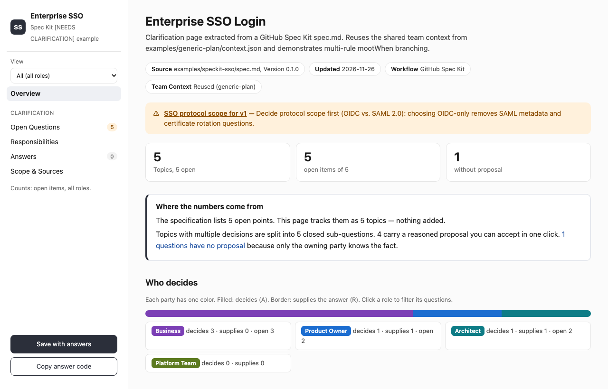

# Punktlandung — Multiplayer `/clarify` for Non-Git Stakeholders

[](https://bor1e.github.io/punktlandung/)
[](https://github.com/bor1e/punktlandung/actions/workflows/ci.yml)
[](https://github.com/bor1e/punktlandung/actions/workflows/version-bump.yml)
[](https://github.com/bor1e/punktlandung/tags)
[](LICENSE)
[](package.json)

**Turn open points in any `plan.md`, GitHub Spec Kit `spec.md`, or OpenSpec `proposal.md` into one offline HTML page where Business, Product, and Architecture select answers — and send them back before an AI coding agent guesses.**

[**Try the Live Interactive Demos →**](https://bor1e.github.io/punktlandung/) · [`examples/speckit-sso`](examples/speckit-sso/) *(English)* · [`examples/steuerbox`](examples/steuerbox/) *(German real-world case)*



---

## Why Not Just Use `/speckit.clarify`, Claude Code, or a PR?

Coding agents (`Claude Code`, `Cursor`, `GitHub Spec Kit /clarify`) clarify **one developer at a time in a terminal**. That breaks down when half the answers belong to **Business, Legal, Operations, or Architecture** who never open a terminal or GitHub PR.

- **Anonymised production case (`examples/steuerbox/`):** A real feature spec had **22 open points + 5 unprovable statements** across **6 roles**. Turning them into one color-coded Punktlandung page organized them into 25 topics / 40 sub-questions and showed Business that only **9 of 40** decisions were theirs (while 35 already carried a reasoned proposal).
- **Zero infrastructure:** One self-contained `.html` file, **0 npm dependencies**, no backend, no logins.
- **Flexible sharing & return path:** Host on your Intranet/Teams Files or share directly (test `.html` hosting in your tenant first — SharePoint Online often downloads `.html` instead of rendering inline, and corporate mail filters often block `.html` attachments). Stakeholders click **"Save with answers"** *or* **"Copy answer code"** (`PKL1:...` — paste straight into an email, Teams, or Slack reply).

> **Good fit vs. limits:** Use Punktlandung when **3+ parties** (some outside Git) need to close **~10–40 closed choices** on a **frozen spec**, with one facilitator reviewing the merge before handing it to an AI agent. **Do NOT use it** when everyone already reviews GitHub PRs, when there are fewer than ~8 questions (a 15-minute call is cheaper), for exploratory/contentious topics, or for formal compliance/audit sign-off (roles are self-declared with no auth, and each respondent should receive their own clean copy rather than forwarding a filled file). Note also that `openCount` is author-supplied and checked against `spec.json`, not parsed from prose.

---

## Where We Start, Where We End

### 1. Where Punktlandung Fits in Your Delivery Lifecycle

```text
  DEFINE        PLAN          CLARIFY          BUILD         VERIFY        SHIP
┌────────┐   ┌────────┐   ╔════════════╗   ┌────────┐   ┌────────┐   ┌────────┐
│  Idea  │   │  Spec  │   ║ Open Pts & ║   │  Code  │   │  Test  │   │   Go   │
│ Refine │──▶│  PRD   │──▶║   RACI     ║──▶│  Impl  │──▶│  Debug │──▶│  Live  │
└────────┘   └────────┘   ╚════════════╝   └────────┘   └────────┘   └────────┘
  /spec        /plan      ▲ PUNKTLANDUNG    /build        /test        /ship
                          │
                          └─ Starts: spec has open points
                             Ends:   0 open points (ready to implement)
```

### 2. Inside Punktlandung — Start to End

```text
  START             EXTRACT           COMPILE           DECIDE             END
┌──────────┐     ┌──────────┐     ┌──────────┐     ┌──────────┐     ┌──────────┐
│ plan.md  │     │  Closed  │     │  Single  │     │  Click   │     │ Decision │
│ + Team   │────▶│ Questions│────▶│   HTML   │────▶│  & Save  │────▶│  Patch   │
└──────────┘     └──────────┘     └──────────┘     └──────────┘     └──────────┘
context.json     init-case.mjs     build.mjs       HTML or PKL1:   merge-answers.mjs
 (define once)    + AI / SKILL    (validated)      paste-back code  (update plan.md)
```

---

## 60-Second Quickstart (Zero Install)

Requires **Node.js 20+**:

```bash
# 1. Scaffold spec.json (+ default context.json) from any plan.md / Spec Kit spec.md / OpenSpec proposal.md
npx github:bor1e/punktlandung#v2.4.0 init path/to/plan.md --out-dir my-case

# 2. Refine options, proposals, and RACI (yourself or with your AI agent via AGENTS.md / SKILL.md),
#    then compile one offline HTML file:
npx github:bor1e/punktlandung#v2.4.0 build my-case/context.json my-case/spec.json -o my-case/open-points.html

# 3. Merge returned .html copies or pasted PKL1: reply codes into an AI-ready patch:
npx github:bor1e/punktlandung#v2.4.0 merge --copilot-prompt my-case/open-points.html returned-biz.html replies.txt
```

*(Pin a release tag like `#v2.4.0` for reproducible runs. Inside a cloned repo, `node scripts/cli.mjs` or `node scripts/{init-case,build,merge-answers,validate}.mjs` runs identically.)*

---

## Install as a GitHub Spec Kit Extension (`hooks.after_clarify`)

If you already use **[GitHub Spec Kit](https://github.com/github/spec-kit)**, install Punktlandung as an extension so every `/speckit.clarify` run prompts to generate a stakeholder HTML page when non-Git decisions remain:

```bash
# Install directly from the v2.4.0 release tag
specify extension add punktlandung \
  --from https://github.com/bor1e/punktlandung/archive/refs/tags/v2.4.0.zip

# Or during local development
specify extension add --dev ./punktlandung
```

This registers an optional `hooks.after_clarify` trigger plus two slash commands:
- `/speckit.punktlandung.clarify` — turns remaining `[NEEDS CLARIFICATION]` markers / open questions in `spec.md` into `open-points.html`.
- `/speckit.punktlandung.merge` — reconciles returned `.html` copies or `PKL1:` codes by `A`-decider authority and updates `spec.md` before `/speckit.plan`.

---

## Use With Your AI Agent

Punktlandung ships ready-made agent integration files so you don't write JSON by hand:

| Agent / Tool | Automatically Loaded File | How to Use |
|---|---|---|
| **Claude Code** | [`CLAUDE.md`](CLAUDE.md) + [`skills/open-points-overview/`](skills/open-points-overview/SKILL.md) | Ask *"Create an open-points overview for `plan.md`"* or copy `skills/open-points-overview/` into `~/.claude/skills/`. |
| **Codex / Cursor / Antigravity / OpenCode** | [`AGENTS.md`](AGENTS.md) + [`skills/open-points-overview/`](skills/open-points-overview/SKILL.md) | Copy `skills/open-points-overview/` into `~/.codex/skills/` or `~/.gemini/skills/` for global reuse across repos. |
| **GitHub Copilot** | [`.github/copilot-instructions.md`](.github/copilot-instructions.md) + [`.github/prompts/clarify-plan.prompt.md`](.github/prompts/clarify-plan.prompt.md) | Run `/clarify-plan` in VS Code Copilot Chat, then feed `merge --copilot-prompt` back to update your spec. |

---

## Examples (`examples/`)

Three English examples **reuse the exact same `context.json`** (`examples/generic-plan/context.json`) — define your team once, clarify many specs. See [examples/README.md](examples/README.md).

| Example | Source Input | Language | Highlights | Live Demo |
|---|---|---|---|---|
| [`examples/speckit-sso/`](examples/speckit-sso/) | GitHub Spec Kit `spec.md` | EN | 5 `[NEEDS CLARIFICATION]` markers, 2 `mootWhen` branches, reused `context.json` | [Open Demo](https://bor1e.github.io/punktlandung/demos/speckit-sso.html) |
| [`examples/generic-plan/`](examples/generic-plan/) | `plan.md` | EN | Minimal `plan.md` (4 Qs, 1 `mootWhen` branch) | [Open Demo](https://bor1e.github.io/punktlandung/demos/generic-plan.html) |
| [`examples/openspec-webhooks/`](examples/openspec-webhooks/) | OpenSpec `proposal.md` | EN | Brownfield delta sign-off before `/opsx:apply`, `PLAT: C`, reused `context.json` | [Open Demo](https://bor1e.github.io/punktlandung/demos/openspec-webhooks.html) |
| [`examples/steuerbox/`](examples/steuerbox/) | Anonymised enterprise spec | DE | Real production case: 4 Use Cases, 26 scenarios, 25 topics, 40 Qs | [Open Demo](https://bor1e.github.io/punktlandung/demos/steuerbox.html) |

---

## How Does This Differ From `arc42`, `req42`, `Spec Kit`, `OpenSpec`, and Business Tools?

### For Engineering & Architecture Teams
| Tool | What it already solves | What Punktlandung adds (without replacing it) |
|---|---|---|
| **[arc42](https://arc42.org/) / [req42](https://req42.de/)** | Static templates for architecture (`arc42`) and agile requirements (`req42`, including stakeholder lists & open points). | Adds the **interactive round-trip compiler** for the open-points section: closed options, one `A` decider per question, and answers embedded back into the file. |
| **[MADR](https://adr.github.io/madr/)** | Recording Architecture Decision Records *after* a decision is reached. | Runs the async clarification loop *before* an ADR or spec update is written. |
| **[GitHub Spec Kit](https://github.com/github/spec-kit) / [OpenSpec](https://github.com/Fission-AI/OpenSpec)** | Developer + AI spec workflows (`/speckit.clarify`, `openspec/changes/`). | Provides the **multiplayer HTML frontend** for non-Git stakeholders on `[NEEDS CLARIFICATION]` / `proposal.md` gates, then feeds decisions back via `--copilot-prompt`. |
| **[TiddlyWiki](https://tiddlywiki.com/)** | Self-saving single-file HTML. | Borrowed its dirty-state guard + `showSaveFilePicker` UX in ~30 lines without a 2 MB wiki runtime. |
| **[SurveyJS](https://surveyjs.io/)** | Schema-driven forms + `visibleIf`. | Borrowed formal JSON Schemas + `mootWhen` branching at 0 KB dependency cost. |

### For Business & Product Stakeholders
| Alternative | Why it stalls | Why Punktlandung works |
|---|---|---|
| **60-minute alignment meeting** | 6 people wait while 2 debate one question; decisions aren't written down. | Everyone filters to *their* colored decisions (`A`), with 2–4 concrete options and a pre-written proposal. |
| **Email threads / Confluence comments** | Replies scatter across 12 threads; nobody knows who has final say. | One file, one `A` decider per question, conflict detection in `merge-answers.mjs`. |
| **MS / Google Forms** | Requires SaaS accounts/hosting, loses spec context, breaks offline, doesn't export back into Git/AI prompts. | Zero server, zero login, runs offline or on SharePoint, exports Markdown/JSON/Copilot prompts directly. |

---

## Repository Layout

| Path | What it is |
|---|---|
| [template/overview.html](template/overview.html) | Generic, zero-dependency DE/EN HTML engine (`#spec-data` + `#saved`, `mootWhen`, TiddlyWiki saver UX, `PKL1:` code + Mail fallback). |
| [schema/context.schema.json](schema/context.schema.json), [schema/spec.schema.json](schema/spec.schema.json) | Draft 2020-12 JSON Schemas for reusable team context and per-`plan.md` specs. |
| [scripts/cli.mjs](scripts/cli.mjs), [scripts/init-case.mjs](scripts/init-case.mjs), [scripts/build.mjs](scripts/build.mjs), [scripts/merge-answers.mjs](scripts/merge-answers.mjs), [scripts/validate.mjs](scripts/validate.mjs) | Zero-dependency `npx` CLI, Markdown scaffolder, HTML compiler, multi-file/`PKL1:` merger, and invariant validator. |
| [test/punktlandung.test.mjs](test/punktlandung.test.mjs) | Automated `node --test` suite covering extraction, validation, building, scaffolding, and answer merging. |
| [AGENTS.md](AGENTS.md), [CLAUDE.md](CLAUDE.md), [.github/copilot-instructions.md](.github/copilot-instructions.md), [skills/open-points-overview/SKILL.md](skills/open-points-overview/SKILL.md) | Cross-agent instructions, skill definition, and Copilot slash prompt. |
| [extension.yml](extension.yml), [config-template.yml](config-template.yml), [commands/](commands/) | Official GitHub Spec Kit extension (`hooks.after_clarify`, `/speckit.punktlandung.clarify`, `/speckit.punktlandung.merge`). |
| [docs/index.html](docs/index.html), [.github/workflows/](.github/workflows/), [.githooks/](.githooks/), [scripts/bump-version.sh](scripts/bump-version.sh) | GitHub Pages live demos, CI test/build checks, automatic SemVer tagging & GitHub Releases. |

---

## The 10 Mindset Principles

1. **Add nothing.** Proposals are marked as proposals; nothing on the page is a requirement unless the spec states it.
2. **Find the keystone question.** Ask the question that removes or creates other questions first (`mootWhen`).
3. **A closed question is a kindness.** 2–4 concrete options take 10 seconds; open-ended *"How should this work?"* starts a meeting.
4. **Recommend where you can. Do not guess facts.** Reasoned proposals make confirmation cheap; guessed facts make specs wrong.
5. **Do not inflate the count.** Split multi-part open points into sub-questions under one topic (`topics <= openCount + unprovableCount`).
6. **One party decides.** Exactly one `A` per question. Define teams once in `context.json`; keep platform teams out of product questions.
7. **Show the whole, color the parts.** One shared page with color-coded role filters preserves cross-team context.
8. **Answers must travel.** `#saved` HTML + `PKL1:` paste-back code + `merge-answers.mjs` close the loop without a backend.
9. **Keep the page to one purpose.** Process documentation belongs in `README.md`, not inside the questionnaire.
10. **Keep the spec's IDs intact.** Readers think in goals/groups; tests and AI bots need spec IDs (`ref`) as the trace.

---

## License, Attribution & Liability

Released under the **[MIT License](LICENSE)**:
- **Free to use, copy, modify, and distribute** (commercially or privately).
- **Attribution / quote required:** Copies or substantial portions of the software must keep the copyright and MIT permission notice (`Copyright (c) 2026 Elyahu Borodin`).
- **No warranty, no liability:** Provided *"AS IS"*, without warranty or liability of any kind.

---

## Versioning & CI/CD

- **Validate & test locally:** `node scripts/validate.mjs && node --test`
- **Version sync:** [VERSION](VERSION), [package.json](package.json), [extension.yml](extension.yml), and [SKILL.md](skills/open-points-overview/SKILL.md) (`version:`) stay in sync.
- **Manual bump:** `./scripts/bump-version.sh [patch|minor|major] [--commit] [--tag]`
- **Automated CI/CD:** [.github/workflows/ci.yml](.github/workflows/ci.yml) runs validation, `node --test`, and reproducible build diffs; [.github/workflows/pages.yml](.github/workflows/pages.yml) deploys live demos to GitHub Pages; [.github/workflows/version-bump.yml](.github/workflows/version-bump.yml) auto-bumps from conventional commits on `main`, pushes `v*` tags, and creates GitHub Releases.
